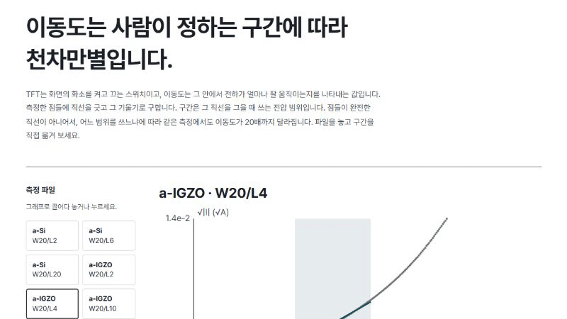

# TFT 피팅 구간 비교 도구

TFT 측정 파일을 놓으면 그래프와 이동도를 계산합니다. 직선을 긋는 구간을 옮기면 이동도가 얼마나 달라지는지 바로 보입니다.

**사이트: https://tft-fit-recheck-site.vercel.app**



## 왜 만들었나

수업에서 받은 TFT 측정 파일은 DAT와 CSV가 섞여 있었습니다. 그래프를 그리는 매크로를 형식마다 따로 짜야 했고, 직선 구간은 눈대중으로 골랐습니다. 이 도구는 두 형식을 같은 방식으로 읽고, 모든 구간의 이동도를 한꺼번에 계산합니다.

## 구간에 따라 얼마나 달라지나

a-IGZO W20/L4 한 소자의 측정을 2 V 구간으로 나눠 계산한 값입니다.

| 구간 (V) | 이동도 (cm²/V·s) | 문턱전압 (V) | R² |
|---|---|---|---|
| 2 ~ 4 | 2.874 | 1.029 | 0.9975 |
| 4 ~ 6 | 5.182 | 1.786 | 0.9992 |
| 6 ~ 8 | 7.459 | 2.486 | 0.9995 |
| 8 ~ 10 | 10.3 | 3.317 | 0.9995 |
| 10 ~ 12 | 14.49 | 4.373 | 0.9994 |
| 12 ~ 14 | 21.76 | 5.789 | 0.9992 |
| 14 ~ 16 | 35.22 | 7.557 | 0.9990 |
| 16 ~ 18 | 56.73 | 9.343 | 0.9994 |

여덟 구간 모두 직선이 잘 맞는데(R² 0.9975 이상) 이동도는 19.7배 차이 납니다. 계산식은 이동도가 전압과 무관하게 일정하다고 가정하지만 실제 소자는 그렇지 않기 때문입니다.

## 계산 방법

```
√|I| = a·V + b        측정한 점에 직선을 맞춘다
μ   = 2·L·a² / (C·W)  이동도
Vth = −b / a          문턱전압
```

게이트와 드레인 전압을 함께 올린 측정(포화 영역)에 쓰는 식입니다. C는 절연막 용량 1.75×10⁻⁸ F/cm²입니다.

## 파일

| 파일 | 하는 일 |
|---|---|
| `recheck/read_raw.py` | DAT·CSV에서 전압과 전류를 읽는다 |
| `recheck/fit.py` | 직선을 맞춰 이동도와 문턱전압을 구한다. 2 V 구간으로 훑는다 |
| `recheck/cases.py` | 확인할 항목 다섯 개를 원자료로 다시 계산한다 |
| `recheck/build.py` | `results/`와 `site/index.html`, `site/data.js`를 만든다 |
| `recheck/__main__.py` | 명령 창구 |
| `site/app.js` | `fit.py`와 같은 계산을 브라우저에서 한다. 화면을 그린다 |
| `site/data.js` | 첫 화면에 보이는 9개 소자의 전압·전류 |
| `results/` | 계산 결과 (JSON) |
| `tests/` | 파이썬 확인 14개, 브라우저 계산과 파이썬 계산의 대조 |

파이썬은 표준 라이브러리만 씁니다. 설치할 것이 없습니다.

## 실행

사이트는 `site/index.html`을 더블클릭하면 열립니다.

```
python -m unittest discover -s tests
```

아래 명령은 원자료가 있어야 돕니다. 원자료는 수업에서 받은 자료라 이 레포에 없습니다([ADR 0001](docs/adr/0001-원자료는-공개하지-않는다.md)).

```
python -m recheck files                      원자료 15개 요약
python -m recheck fit IGZO2004.csv 5.5 9.5   한 구간의 이동도와 문턱전압
python -m recheck sweep IGZO2004.csv         파일 하나의 구간별 표
python -m recheck case 2                     확인 항목 2번 (1~5번)
python -m recheck build                      results/ 와 site/ 를 다시 만든다
node tests/check_js.js                       브라우저 계산을 파이썬 값과 대조
```

## 만든 과정

AI(Claude Code)와 함께 만들었습니다. 무엇을 정했고, AI의 제안 중 무엇을 받아들이고 거절했는지, AI가 무엇을 틀렸고 어떻게 찾았는지 적어 두었습니다.

- [docs/AI협업기록.md](docs/AI협업기록.md): 단계마다 있었던 일
- [docs/설계.md](docs/설계.md): 설계
- [docs/adr/](docs/adr/): 결정과 이유
- [GLOSSARY.md](GLOSSARY.md): 용어
